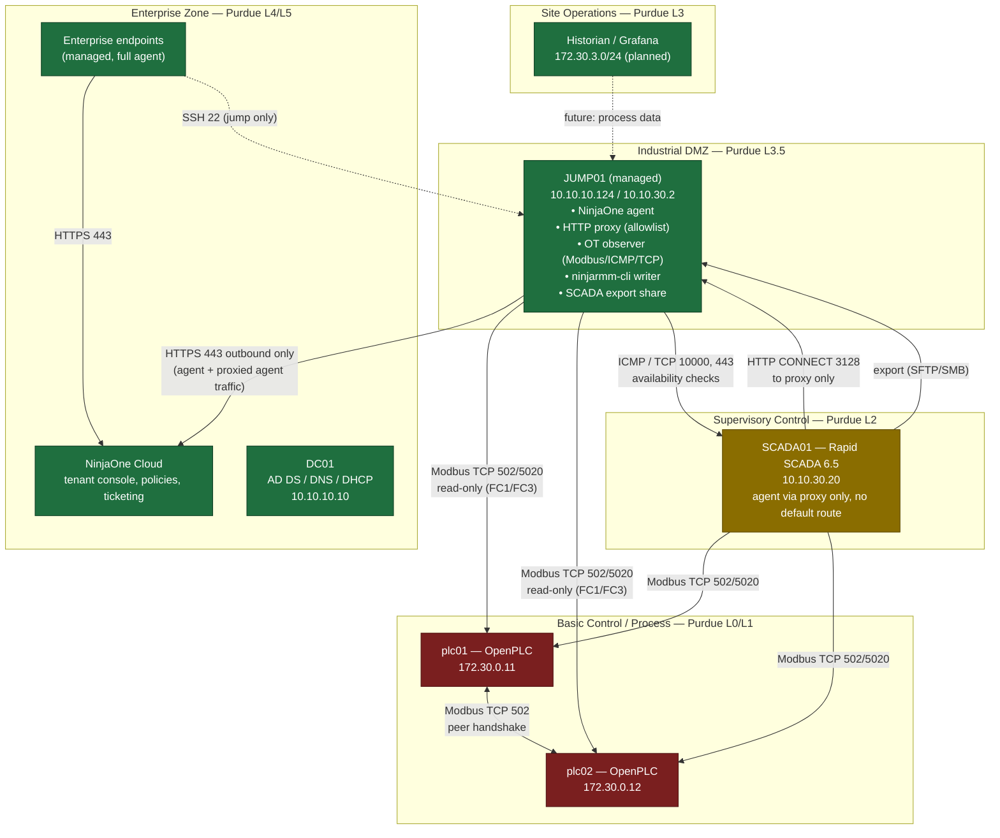
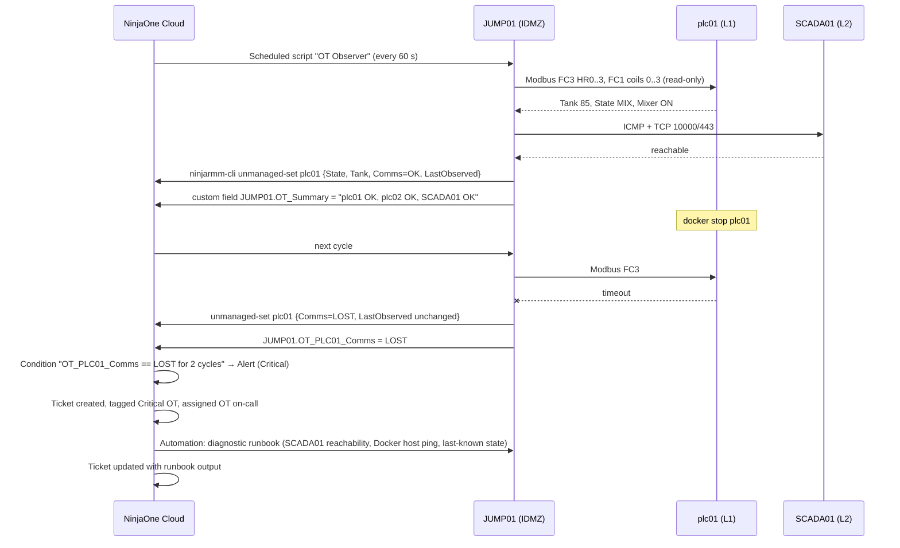

# NinjaOne for Industrial Environments — Phase 2: Reference Architecture

**Title:** Governing the IT Layer of Industrial Control Systems with NinjaOne — an IEC 62443-aligned Reference Architecture
**Document status:** v1.0 — 2026-10-01
**Classification:** INTERNAL draft. Sections marked **[INT]** are internal-only and must be removed from any customer-facing version.
**Depends on:** Phase 0 (evidence, signals S-xx), Phase 1 (business model, decisions D-1…D-6)
**Audience:** Sales Engineers, Account Executives, Product Management, and — once sanitized — prospect IT/OT/Security teams

---

## 1. Purpose and how to use this document

This document defines **where NinjaOne components are allowed to exist in an industrial network, which flows they require, and which flows are explicitly denied**, using the vocabulary industrial customers and auditors already use: IEC 62443-3-2 zones and conduits mapped to the Purdue Enterprise Reference Architecture (ISA-95 levels).

It is written to be attached, after sanitization, to a request such as S-01 ("show us architecture documentation for using NinjaOne in OT and confirm a proxy at Level 4 is viable"). Every design statement is implemented and verifiable in the reference lab described in Section 12.

**Guiding principle:** *Manage Levels 3.5–5 like IT. Observe Level 2. Document Level 0–1. Never touch the process.*

---

## 2. Standards basis

| Standard | What we take from it |
|---|---|
| **IEC 62443-3-2** | Partitioning of the system under consideration into *zones* (groupings of assets with common security requirements) and *conduits* (controlled communication paths between zones). Every flow in this document is a conduit with a declared direction, protocol and justification. |
| **IEC 62443-3-3 / 2-1** | Foundational requirements we support in the IT layer: identification and authentication control, use control, restricted data flow, timely response to events, resource availability. |
| **Purdue / ISA-95** | Level numbering (0–5) used as a shared language for *where* an asset sits. |
| **NIST SP 800-82 r3** | Guidance that management and security tooling belongs in the industrial DMZ and enterprise levels, with no direct enterprise-to-control-network paths. |

NinjaOne is not an OT security product and makes no claim of IEC 62443 certification. The claim this architecture makes is narrower and defensible: **NinjaOne can be deployed so that it does not violate a customer's IEC 62443 zone-and-conduit design, and it produces the evidence to prove it.**

---

## 3. Zone model

| Zone (IEC 62443) | Purdue level | Typical assets | NinjaOne posture | Lab realization |
|---|---|---|---|---|
| **Enterprise Zone** | L4–L5 | Domain controllers, provisioning, office endpoints, NinjaOne Cloud | **Managed.** Full agent: patching, policies, remote, backup, ticketing | `NAT-SW` 10.10.10.0/24 — DC01, DEPLOY01, Windows/Linux endpoints |
| **Industrial DMZ (IDMZ)** | L3.5 | Jump host, proxy/egress, historian publication, OT observers | **Managed + sole egress.** Agent; HTTP proxy; observer scripts; `ninjarmm-cli` writer for unmanaged records; export share | JUMP01 `ubusrv-0a0201`, dual-homed 10.10.10.124 / 10.10.30.2 |
| **Site Operations Zone** | L3 | Historian, Grafana, engineering file servers | Managed via IDMZ (server policy, production-aligned patch windows) | `ot-historian` 172.30.3.0/24 (PostgreSQL/Grafana, planned) |
| **Supervisory Control Zone** | L2 | SCADA/HMI servers, engineering workstations | **Unmanaged-monitorable → Managed via IDMZ proxy** (D-3/D-4). No default route. No Backup agent | SCADA01 `ubusrv-0a0203` 10.10.30.20 (Rapid SCADA 6.5) on `OT-SW` |
| **Basic Control / Process Zone** | L0–L1 | PLCs, RTUs, drives, I/O | **Unmanaged device records only.** Never agented. Never routed. Health observed from IDMZ over the SCADA-approved protocol | `ot-field` 172.30.0.0/24 (internal) — plc01 172.30.0.11, plc02 172.30.0.12 (OpenPLC v4); Modbus published only on 10.10.30.10:502/5020 |

### 3.1 Architecture diagram

Legend: green = NinjaOne agent present; amber = agent present only via IDMZ proxy (or unmanaged-monitorable before authorization); red = no NinjaOne software, ever.

---

## 4. Conduit and flow matrix

Every permitted flow. Anything not listed is denied.

| ID | From zone | To zone | Protocol / port | Direction | Purpose | Enforcement in lab |
|---|---|---|---|---|---|---|
| C-01 | IDMZ (JUMP01) | Enterprise / Internet (NinjaOne Cloud) | TCP 443 outbound | → | Agent check-in for JUMP01 **and** proxied agent traffic for L2 hosts | JUMP01 is the only OT-side host with a default route; Squid allowlist restricted to NinjaOne tenant endpoints (per Dojo region list) |
| C-02 | Enterprise endpoints | NinjaOne Cloud | TCP 443 outbound | → | Standard agent traffic | Standard |
| C-03 | Enterprise (admin workstation) | IDMZ (JUMP01) | TCP 22 (SSH) | → | Jump access to OT side; tunnels defined in `~/.ssh/config` | Only path from L4 toward L2; AD-authenticated, group-restricted |
| C-04 | Supervisory (SCADA01) | IDMZ (JUMP01) | TCP 3128 (HTTP CONNECT) | → | NinjaOne agent egress **only** | SCADA01 has no default route; proxy allowlist denies everything except NinjaOne endpoints |
| C-05 | IDMZ (JUMP01) | Supervisory (SCADA01) | ICMP; TCP 10000, 443 | → | Availability observation (unmanaged-monitorable phase and ongoing) | Observer script in `/root/otmon` |
| C-06 | IDMZ (JUMP01) | Process (plc01/plc02 via Docker publish) | TCP 502, 5020 — Modbus FC1/FC3 only | → | Health observation written to unmanaged records | pymodbus client, read-only function codes; published on 10.10.30.10 only |
| C-07 | Supervisory (SCADA01) | Process (plc01/plc02) | TCP 502, 5020 — Modbus | → | SCADA polling and (later) manual override commands | Native SCADA function; not a NinjaOne path |
| C-08 | Process (plc01) | Process (plc02) | TCP 502 — Modbus | ↔ | PLC peer handshake over `ot-field` | Docker internal network; no external exposure |
| C-09 | Supervisory (SCADA01) | IDMZ (JUMP01) | SFTP 22 or SMB 445 | → | Rapid SCADA project/config export for backup | Scheduled export; share backed up by NinjaOne Backup on JUMP01 |
| C-10 | Supervisory / IDMZ | Enterprise (DC01) | DNS 53, Kerberos 88, LDAP 389/636, NTP 123 | → | AD authentication, name resolution, time | **See 4.1** |

### 4.1 Explicitly denied flows (the part auditors ask for)

| Denied | Why | How the lab proves it |
|---|---|---|
| Any zone below L3.5 → Internet (direct) | Single egress principle | `ip route` on SCADA01 shows no default route; `OT-SW` host adapter has TCP/IP unbound; `ot-field` is `internal: true` |
| Enterprise → Supervisory or Process (direct RDP/SSH/HTTP) | No enterprise-to-control paths | Only C-03 exists; tunnels terminate on JUMP01 |
| NinjaOne Cloud → anything (inbound) | Agent model is outbound-only | No inbound NAT/firewall rules |
| NinjaOne agent or installer on L0–L1 | Policy D-2 | Container images unchanged; no agent packages present |
| Modbus write function codes from IDMZ observer | Observation is read-only | pymodbus client restricted to FC1/FC3; code reviewed |
| Backup agent traffic through proxy | Unsupported (S-03) | No Backup role on SCADA01; export-and-backup pattern instead |

**Note on C-10 (AD from L2):** in the lab, SCADA01 and JUMP01 are AD-joined against DC01 in the Enterprise Zone. A production IEC 62443 design would place a read-only domain controller and DNS/NTP forwarders inside the IDMZ so that L2 never addresses L4 directly. This is a documented deviation of the lab, not of the reference architecture; the recommended production pattern is stated in Section 13.

---

## 5. Component roles

### 5.1 NinjaOne Cloud (Enterprise Zone, SaaS)
Tenant console; device policies per zone (`OT-IDMZ-Servers`, `OT-L2-Supervisory`, `OT-L3-SiteOps`); ITAM unmanaged device roles; conditions, alerts, ticketing, automations; audit log export.

### 5.2 IDMZ host — JUMP01 (the architectural keystone)

| Function | Component | Notes |
|---|---|---|
| Managed endpoint | NinjaOne agent | Full policy; this is where NinjaOne "lives" on the OT side |
| Sole egress | HTTP proxy (Squid) on 10.10.30.2:3128 | Allowlist of NinjaOne endpoints only; deny-by-default; access log retained. Positioned as *customer-supplied proxy, upgradeable to NinjaOne Proxy* (D-5) |
| OT observer | Python (pymodbus) in `/root/otmon`, run by NinjaOne scheduled script | Reads PLC coils/holding registers (FC1/FC3), pings SCADA01, checks TCP 10000/443 |
| Asset writer | `ninjarmm-cli unmanaged-set` | Writes observed values into custom fields of unmanaged records (plc01, plc02, SCADA01 pre-agent) |
| Jump host | SSHD, AD-restricted | Only L4 → L2 path; session logging |
| Export landing zone | SFTP/SMB share | Receives Rapid SCADA exports; backed up by NinjaOne Backup |

### 5.3 Supervisory host — SCADA01
Rapid SCADA 6.5 (Server 10000, Agent 20002 host-side mapping, Webstation 443). Lifecycle: unmanaged-monitorable record → agent installed with proxy config → managed under `OT-L2-Supervisory` policy. No default route. No Backup agent.

### 5.4 Process hosts — plc01, plc02
OpenPLC Runtime v4 containers on OT-HOST01 (no agent on the Docker host either). Represented in NinjaOne exclusively as ITAM unmanaged devices with role `PLC`.

---

## 6. Asset model (ITAM)

### 6.1 Unmanaged device roles

| Role | Used for | Custom fields |
|---|---|---|
| `OT-PLC` | plc01, plc02 | `Zone` (L1), `Protocol` (Modbus TCP), `Address` (172.30.0.11 / published 10.10.30.10:502), `Vendor/Runtime` (OpenPLC v4), `Process State` (FILL/MIX/READY/TRANSFER or CONSUME/REQUEST/RECEIVE), `Tank Level %`, `Comms Status` (OK/LOST), `Last Observed` (UTC), `Criticality` (Critical OT), `Monitored By` (JUMP01) |
| `OT-SCADA-Server` | SCADA01 before agent authorization | `Zone` (L2), `Software` (Rapid SCADA 6.5), `Reachability` (OK/LOST), `Service Ports` (10000, 443), `Criticality` (Critical OT), `Agent Authorized` (yes/no) |
| `OT-Network-Device` | industrial switches without SNMP (future) | `Zone`, `Management IP`, `Criticality` |

### 6.2 Relationships
`plc01 → Monitored by → JUMP01`; `plc01 → Supervised by → SCADA01`; `SCADA01 → Egress via → JUMP01`. Relationships give the topology/criticality view requested in S-07 without a dedicated feature.

### 6.3 Lifecycle
`Unmanaged` (PLCs, permanent) · `Unmanaged, monitorable` (SCADA01 until authorized) · `Managed` (SCADA01 after agent). Decommission path per ITAM lifecycle.

---

## 7. Observation and alerting pipeline

Design notes:
- Conditions evaluate on **JUMP01's custom fields** (a managed device) while the human-readable state lives on the **unmanaged records**. This is a NinjaOne-native pattern: alerting on the observer, documenting on the observed.
- Two consecutive failures before alerting avoids flapping; the interval is a tunable in the observer.
- The runbook never writes to the PLC. Remediation of the process is the SCADA/OT team's job; NinjaOne gives IT the ticket, the context and the audit trail.

---

## 8. Deployment variants

| Variant | Scope | When to use | Lab coverage |
|---|---|---|---|
| **V1 — Enterprise + IDMZ only** | Agents on L4–L5 and on the IDMZ host; everything below observed and documented | OT team forbids any agent in L2 | JUMP01 managed; SCADA01 unmanaged-monitorable; PLCs unmanaged (= lab before D-3 step) |
| **V2 — Restricted segment via proxy** (reference) | V1 + agents on L2/L3 hosts egressing only through the IDMZ proxy | OT team authorizes agents on supervisory servers with no direct internet | Full lab target (D-3) |
| **V3 — Fully isolated plant** | No outbound path from site at all | Regulated/air-gapped sites | Not demonstrable today; see **[INT] Annex A** |

Upgrade path: V1 → V2 is a per-host decision, reversible, with the same records. V2 → V3 depends on product availability.

---

## 9. Identity and access

| Control | Implementation | Zone |
|---|---|---|
| Tenant access | MFA enforced; RBAC roles `OT-Viewer`, `OT-Operator`, `OT-Admin`; IP allowlisting of admin origins | Cloud |
| Device-level scoping | Separate NinjaOne organization or location per plant; OT policies cannot be applied to enterprise devices and vice versa | Cloud |
| Host access to L2 | Only via JUMP01 (C-03); AD group `GG-OT-Admins` → `realm permit`; sudo via `/etc/sudoers.d/90-lab-ot-admins`; SSH session logging | IDMZ |
| Remote sessions | NinjaOne Remote to SCADA01 traverses the proxy like any agent traffic; no RDP/VNC exposed on `OT-SW` | L2 |
| Observer credentials | Modbus requires none; SCADA API (future) uses a read-only account stored in NinjaOne secure custom field | IDMZ |
| CLI writer | `ninjarmm-cli` runs under the agent's context on JUMP01; technician permission "ITAM: update unmanaged devices" scoped to the OT organization | IDMZ |
| Proxy | Allowlist by destination FQDN; no authentication bypass; access log shipped as evidence | IDMZ |

---

## 10. Patching and maintenance in Level 2

- SCADA01 is in policy `OT-L2-Supervisory`: approvals manual, reboots never automatic.
- Maintenance window is **gated by process state**: the observer writes `JUMP01.OT_Process_Idle = true` when plc01 is in READY and plc02 in CONSUME with Tank 2 > 40 %; the patch automation on SCADA01 runs only when that field is true and within the production calendar. If the state changes mid-window, the automation aborts before reboot.
- Patch content reaches SCADA01 through the same proxy (C-04). Microsoft/Ubuntu update endpoints must be in the proxy allowlist for the duration of the window, or patch caching is used upstream (per S-04 guidance).

---

## 11. Backup, recovery and evidence

| Need | Pattern |
|---|---|
| SCADA configuration | Scheduled export of the Rapid SCADA project to JUMP01 share (C-09); NinjaOne Backup protects the share |
| PLC programs | `.st` sources and OpenPLC runtime volumes archived from OT-HOST01 to the same share by the existing `backup.sh`; documented as attachment on the unmanaged record |
| Audit evidence for segmentation | Exported route tables (`ip route` SCADA01, JUMP01), Squid allowlist and access log, Docker network definitions, NinjaOne activity log |
| Incident evidence | Ticket with runbook output; custom field history on unmanaged records |

---

## 12. Lab bill of materials (what Phase 3 implements)

| Step | Component | Zone | New / existing |
|---|---|---|---|
| 1 | ITAM roles `OT-PLC`, `OT-SCADA-Server`; unmanaged records plc01, plc02, SCADA01 | Cloud | New |
| 2 | Observer script `/root/otmon/ot_observer.py` (pymodbus, ping, TCP) + `ninjarmm-cli` writer; NinjaOne scheduled script every 60 s | IDMZ | New (venv exists) |
| 3 | Custom fields on JUMP01 (`OT_PLC01_Comms`, `OT_PLC02_Comms`, `OT_SCADA01_Reach`, `OT_Process_Idle`, `OT_Summary`); conditions; alert; ticket template; diagnostic runbook | Cloud + IDMZ | New |
| 4 | Squid on JUMP01 with NinjaOne allowlist; firewall on JUMP01 limiting 3128 to 10.10.30.0/24 | IDMZ | New |
| 5 | NinjaOne agent on SCADA01 configured for proxy 10.10.30.2:3128; verify no default route; record transitions to managed | L2 | New |
| 6 | Policy `OT-L2-Supervisory` with state-gated maintenance automation | Cloud | New |
| 7 | Rapid SCADA export job → JUMP01 share → NinjaOne Backup | L2 + IDMZ | New |
| — | DC01, DEPLOY01, JUMP01 agent, OT-SW, Docker networks, PLC programs, Rapid SCADA, SSH tunnels | all | Existing, unchanged (D-1) |

---

## 13. Deviations of the lab from a production deployment

| Topic | Lab | Production recommendation |
|---|---|---|
| AD from L2 | SCADA01 authenticates directly to DC01 (L4) | RODC + DNS/NTP forwarders in the IDMZ |
| Firewalling | Enforced by Hyper-V switch isolation, Docker `internal` networks and host firewall | Dedicated industrial firewall between each zone pair with rules equal to Section 4 |
| Proxy | Squid, single instance | HA proxy pair or NinjaOne Proxy when GA; TLS inspection off for agent traffic |
| PLCs | OpenPLC containers | Vendor PLCs; observation protocol per vendor (Modbus, OPC-UA, S7) through the SCADA-approved path only |
| Scale | 1 site, 2 PLCs | One IDMZ host per site; one tenant; organizations per plant |

---

## 14. What NinjaOne deliberately does not do here

1. Install anything on PLCs, RTUs, drives or safety systems.
2. Write to process variables from the observer or from any automation.
3. Open inbound paths from the cloud or from the enterprise into L2 or below.
4. Replace SCADA, historian, or OT security monitoring (Claroty, Nozomi, Dragos coexist above the IDMZ as data consumers).
5. Run Backup agents on hosts that can only reach the cloud through a proxy.

Saying these out loud is part of the architecture.

---

## 15. Acceptance tests for Phase 3

| ID | Test | Pass criterion |
|---|---|---|
| AT-01 | `docker stop plc01` on OT-HOST01 | Alert in NinjaOne ≤ 2 observer cycles; ticket created with runbook output; plc01 record shows `Comms = LOST` |
| AT-02 | `docker start plc01` | Alert auto-resolves; record returns to `Comms = OK` with fresh `Last Observed` |
| AT-03 | SCADA01 `ip route` and `curl https://example.com` | No default route; direct egress fails |
| AT-04 | Agent on SCADA01 via proxy | Device online in console; Squid log shows only NinjaOne destinations |
| AT-05 | Attempt from SCADA01 to any non-allowlisted FQDN via proxy | HTTP 403 from Squid |
| AT-06 | Attempt RDP/SSH from an enterprise endpoint directly to 10.10.30.20 | Unreachable |
| AT-07 | Patch window with plc01 in TRANSFER | Automation aborts; no reboot |
| AT-08 | Patch window with process idle | Automation runs; compliance report updated |
| AT-09 | Observer code review | Only FC1/FC3 used; no write function codes |
| AT-10 | SCADA export → Backup | Restore point visible in NinjaOne Backup |

---

## [INT] Annex A — Product roadmap mapping (internal only)

| Reference architecture element | Today | Roadmap component (status per Phase 0 §5) |
|---|---|---|
| IDMZ egress (C-01/C-04) | Customer-supplied Squid | **NinjaOne Proxy** — alpha/pre-beta, PM Reed Woods |
| V3 fully isolated plant | Not possible | **NinjaOne Airgap** mode A (`ninjaone_bridged`) replaces the proxy in the IDMZ; modes B (one-way guard), C (standalone), D (bundle pair) cover diode and sneakernet sites. EA prototype; status statements conflict — verify with James Hoscheit before any external mention |
| Legacy OS in L2/L3 | Unmanaged records | Airgap agent targets Solaris/AIX/BSD/embedded Linux |
| Patching in isolated segments without upstream proxy | Not supported (S-04) | Airgap `patch_install` with operator-staged catalog |
| Critical IT / Critical OT classification, topology export | Custom fields + relationships | Product feedback item (S-07) |
| Backup via proxy | Unsupported (S-03) | Product feedback item |

---

*End of Phase 2.*
